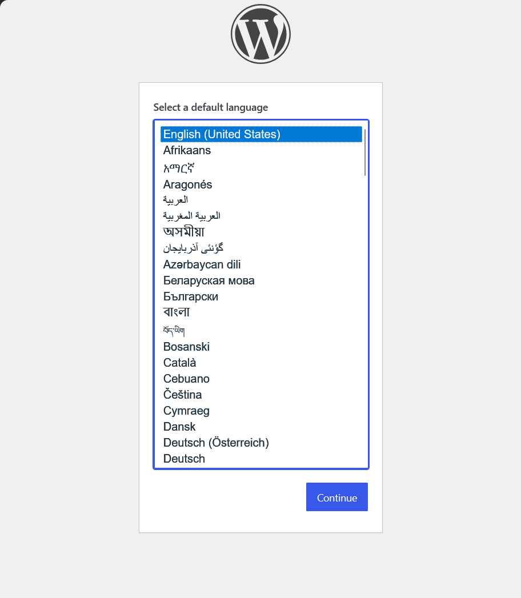
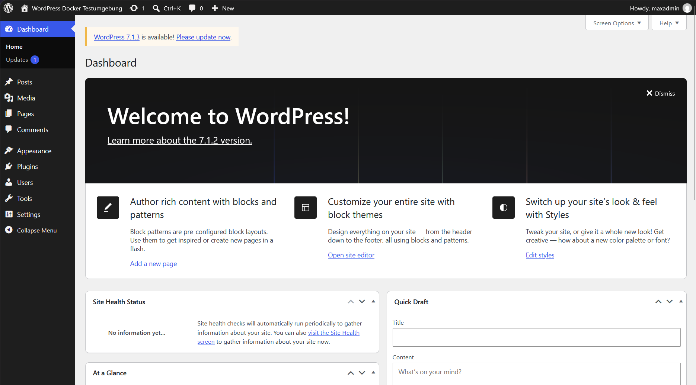
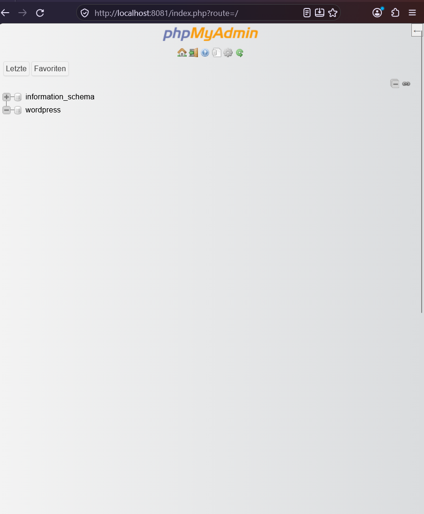

# WordPress-Docker-Testumgebung

Lokale WordPress-Testumgebung für die Schulaufgabe im Bereich Git und Docker. Das Projekt verwendet **Docker Compose** mit **WordPress**, **MariaDB** und **phpMyAdmin**. Alle Dienste laufen lokal unter Windows 11 mit Docker Desktop.

## Voraussetzungen

- Windows 11 mit Docker Desktop (Docker Compose enthalten)
- Git und Git Bash
- Freie lokale Ports **8080** und **8081**

## Projektstruktur

```text
wp-int-Witt/
├── docker-compose.yml          # Container und Konfiguration
├── .env.example                # Vorlage für lokale Zugangsdaten
├── .gitignore                  # Schließt sensible/lokale Dateien aus
├── README.md                   # Diese Anleitung
├── KI_PROMPTS.md               # Dokumentation der KI-Nutzung
├── wordpress/
│   └── wp-content/             # WordPress-Inhalte als Bind-Mount
└── screenshots/
    ├── wordpress.png
    ├── wordpress_eingerichtet.png
    └── phpmyadmin.png
```

## 1. Installation und Einrichtung

Repository klonen und in den Projektordner wechseln:

```bash
git clone https://github.com/einsMaxx/wp-int-Witt.git
cd wp-int-Witt
```

Die Vorlage für die Umgebungsvariablen kopieren:

```bash
cp .env.example .env
```

Die Datei `.env` öffnen und **eigene Passwörter** festlegen:

```env
DB_NAME=wordpress
DB_USER=wpuser
DB_PASSWORD=HIER_EIN_EIGENES_PASSWORT_EINTRAGEN
DB_ROOT_PASSWORD=HIER_EIN_ANDERES_PASSWORT_EINTRAGEN
```

Die Datei `.env` enthält Zugangsdaten und darf **nicht auf GitHub hochgeladen** oder in eine Abgabe-ZIP aufgenommen werden. Die `.env.example` dient nur als Vorlage.

## 2. Docker-Umgebung starten

Konfiguration prüfen:

```bash
docker compose config --quiet
```

Container starten und ihren Status anzeigen:

```bash
docker compose up -d
docker compose ps
```

Die Datenbank hat einen Healthcheck. WordPress und phpMyAdmin starten abhängig von einer gesunden Datenbankverbindung.

## 3. Anwendungen aufrufen

| Anwendung | Adresse | Zweck |
|---|---|---|
| WordPress | http://localhost:8080 | Website und Administration |
| WordPress-Administration | http://localhost:8080/wp-admin/ | Beiträge und Einstellungen verwalten |
| phpMyAdmin | http://localhost:8081 | MariaDB im Browser verwalten |

Bei der ersten WordPress-Anmeldung den Einrichtungsassistenten abschließen und einen eigenen Administratorbenutzer erstellen. Für phpMyAdmin die Werte `DB_USER` und `DB_PASSWORD` aus der lokalen `.env` verwenden.

## 4. Datenspeicherung (Persistenz)

Die Daten werden auf zwei Arten gespeichert:

- **MariaDB:** Das Docker-Named-Volume `db_data` speichert die Datenbank dauerhaft.
- **WordPress-Dateien:** Der Ordner `wordpress/wp-content` ist als Bind-Mount mit dem Container verbunden und enthält beispielsweise Plugins, Themes und Uploads.

**Durchgeführter Test:** WordPress wurde eingerichtet und ein Testbeitrag veröffentlicht. Danach wurden die Container mit `docker compose restart` neu gestartet. Der Testbeitrag war weiterhin vorhanden. Damit wurde die Datenspeicherung über einen Containerneustart hinweg erfolgreich geprüft.

Hinweis: Dieser Test belegt die Persistenz beim Neustart. Das Löschen des Datenbank-Volumes würde die gespeicherten Daten entfernen.

## 5. Screenshots

### WordPress-Installationsassistent



### Eingerichtetes WordPress



### phpMyAdmin



## 6. Wichtige Docker-Befehle

| Befehl | Funktion |
|---|---|
| `docker compose up -d` | Container im Hintergrund starten |
| `docker compose ps` | Containerstatus anzeigen |
| `docker compose logs --tail=50 db` | MariaDB-Protokoll anzeigen |
| `docker compose restart` | Container neu starten |
| `docker compose down` | Container stoppen und entfernen; Datenbank-Volume bleibt erhalten |

**Achtung:** `docker compose down -v` entfernt zusätzlich das Datenbank-Volume und kann WordPress-Daten unwiderruflich löschen.

### Fehlerbehebung: Datenbankverbindung

Bei der Meldung `Error establishing a database connection` zuerst prüfen:

1. Existiert die `.env` und sind `DB_NAME`, `DB_USER`, `DB_PASSWORD` und `DB_ROOT_PASSWORD` gesetzt?
2. Zeigt `docker compose ps` MariaDB als `healthy` an?
3. Enthält `docker compose logs --tail=50 db` Anmeldefehler?

Bei einer bereits initialisierten MariaDB werden bestehende Benutzerpasswörter durch Änderungen an `.env` **nicht automatisch angepasst**. Vor Änderungen an Volumes müssen vorhandene Daten gesichert werden.

## 7. GitHub-Workflow

Die Entwicklung erfolgte über einen Feature-Branch und einen Pull Request nach `main`. Für `main` wurde ein Ruleset mit verpflichtender Pull-Request-Freigabe eingerichtet. Der Pull Request wurde geprüft, genehmigt und gemergt. Die ergänzte Abschlussdokumentation wurde ebenfalls über einen Pull Request übernommen.

Repository: https://github.com/einsMaxx/wp-int-Witt

> Hinweis zur Schulabgabe: Das ursprüngliche Organisations-Repository lautet `BKUerdingen/wp-int-Witt`. Die Zulässigkeit des persönlichen Repositories als Abgabeort muss gegebenenfalls mit der Lehrkraft geklärt werden.

## 8. Hinweise zur Testumgebung

Diese Konfiguration ist für die **lokale Entwicklung und Schule**, nicht für den produktiven öffentlichen Betrieb vorgesehen. WordPress und phpMyAdmin sind über lokale Host-Ports erreichbar. Zugangsdaten gehören ausschließlich in die lokale `.env`.
